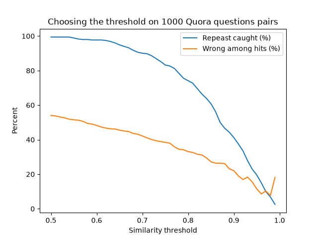

1. SemCache

A semantic cache for LLM applications, written in Python. It recognises repeated questions, even when they are worded differently, and answers them from memory instead of calling the AI again

2. The problem

LLM APIs cost money and take seconds to respond, yet many user questions are repeats ("How do I reset my password?" and "I forgot my password, help"). An exact-match cache misses these, because the text differs.

3. How it works

Every question follows this path, cheapest and safest check first:

question
   |
   v
exact match in cache? ----yes----> return saved answer (hit)
   | no
   v
similar meaning above threshold? --yes--> return saved answer (hit)
   | no
   v
ask the LLM -> save the answer with an expiry time -> return it (miss)

4. Design decisions 
(1) Part
(2) Choice 
(3) Why

1. Storage 
2. LRU cache built from scratch: hash map + doubly linked list 
3. O(1) lookup and O(1) move-to-front |

1. Eviction 
2. Remove the node before the tail 
3. Least recently used is evicted when full 

1. Expiry 
2. TTL per answer, min-heap of expiry times, lazy deletion 
3. Stale answers are never served; cleanup never scans everything 

1. Meaning 
2. Sentence embeddings (all-MiniLM-L6-v2, 384 numbers) + cosine similarity written from scratch 
3. Compares meaning, not letters 

1. Safety 
2. Similarity threshold chosen from data 
3. A wrong answer is worse than a missed saving 

1. Service 
2. FastAPI with a lock around the cache 
3. Requests can arrive together; the lock prevents corrupting the linked list.

5. Results

Measured on 1,000 random labelled pairs from the public Quora Question Pairs dataset (validation split, 352 duplicates).

| Threshold | Repeats caught | Wrong among hits |
| 0.80 |         | 74% |             | 33% |
| 0.90 |         | 41% |             | 22% |
| 0.95 |         | 20% |             | 12% |
| 0.96 |         | 15% |              | 9% |

- **Chosen threshold: 0.96.** A wrong answer costs more than a missed saving. At 0.96 only about 50 hits occurred, so the wrong-hit rate is roughly 10%, not exactly 9%.
- On this dataset no threshold gave both high savings and low errors, because many "different" questions are about the same topic with a small change.
- **Overhead:** about 25 ms per request with 100 saved questions. With a 1-second AI call the cache breaks even at a 2.5% hit rate.
- **The threshold benchmark does not call an AI**; it only tests whether the cache matches questions correctly. The demo calls a real Gemini model (`gemini-3.5-flash-lite`). In one test, a miss took 5.31 s and a reworded repeat was answered from memory in 0.02 s. That is a single example, not an average. The automated tests use a simulated AI (`fake_llm`) so they run offline and free.
- The web demo runs at a looser threshold of 0.8, only so that similar questions visibly hit. The recommended setting is 0.96.

6. Complexity

| Operation |         | Cost |

| get / put (LRU) |    | O(1) average |
| expiry cleanup |     | O(log n) per expired entry |
| similarity search |   | O(n) comparisons per lookup |

7. Known limits

- Even at 0.96, about 1 in 10 hits is wrong on this dataset.
- The similarity search checks every saved question, so it will not scale to millions. Next step: an approximate nearest-neighbour index and a shared store such as Redis.
- The embedding is computed twice on a miss.
- The cache lives in memory and is emptied on restart.
- The lock is held during the AI call, so other requests wait.
- The demo sets no expiry time (TTL), so cached answers never expire. AI answers can also be out of date, so a real service should set a TTL.
- The free Gemini tier has rate limits. If the AI call fails, the API returns a 503 message instead of crashing.

8. Run it

Requires Python 3.12 (the PyTorch library used for embeddings may not support newer versions on Windows yet).

py -3.12 -m venv .venv
.venv\Scripts\Activate.ps1
pip install -r requirements.txt
pytest
uvicorn api:app --reload
The demo calls the Gemini API, so it needs a free API key from https://aistudio.google.com/apikey. Save it as an environment variable, then open a new terminal:

setx GEMINI_API_KEY "your-key-here"

Never put the key in the code or commit it to GitHub. Without a key, the demo returns a 503 error message.

Then open http://127.0.0.1:8000/ for the demo page and http://127.0.0.1:8000/stats for statistics.

9. Files

- `lru.py`: LRU cache with expiry (hash map, doubly linked list, heap)
- `similarity.py`: cosine similarity and nearest-match search
- `embedder.py`: sentence embeddings
- `semantic_cache.py`: the full journey of a question
- `llm_client.py`: the AI adapters, `real_llm` (Gemini) and `fake_llm` (simulated, used by tests)
- `api.py`, `index.html`: web service and demo page
- `compute_scores.py`, `analyze.py`, `make_chart.py`: threshold benchmark
- `test_*.py`: automated tests